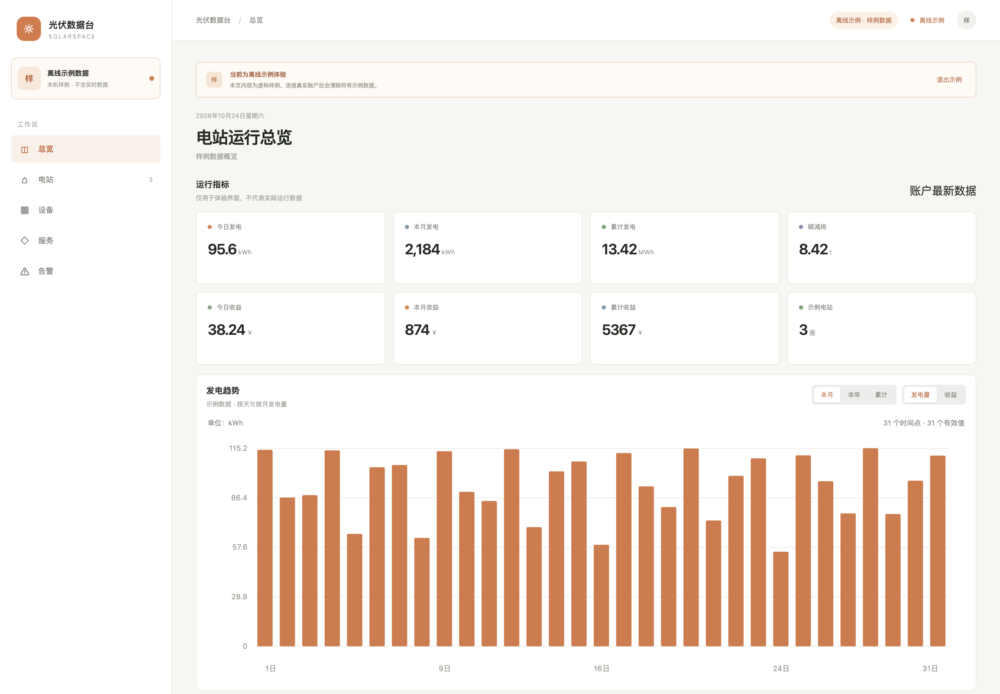

> 非官方开源项目，与爱士惟（AISWEI）无关联。应用只读取用户自己账户里的数据，不提供任何写入、删除或远程控制能力。

# SOLARSPACE · macOS 桌面客户端

SOLARSPACE 是一个本机运行的 Apple Silicon macOS 客户端。它提供爱士惟账户只读连接、电站与设备查看、总览发电趋势（本月按天 / 本年按月 / 累计按年，可切换发电量与收益）、电站实时能流与运行档案、跨电站告警中心、逆变器实时数据、发电统计（本月 / 本年，直流与交流）和历史折线图、质保查询、离线示例模式及 CSV 导出。日常使用直接打开 `.app`，不需要启动网页服务器。



## 构建与运行

需要 Node.js 22.18 或更新版本。

```sh
npm install
npm run desktop:start     # 编译界面并以桌面应用启动
npm test                  # 运行本地测试
npm run desktop:build     # 打包当前平台
```

指定平台与架构打包：

```sh
node scripts/package.cjs --platform=darwin --arch=arm64   # macOS Apple Silicon
node scripts/package.cjs --platform=darwin --arch=x64     # macOS Intel
node scripts/package.cjs --platform=win32  --arch=x64     # Windows（建议在 Windows 上执行）
```

产物位于 `release/SolarSpace-<platform>-<arch>/`。也可以直接从 [Releases](https://github.com/loooo139/solarspace/releases) 下载 CI 构建好的安装包。

### 平台支持

| 平台 | 状态 | 说明 |
|---|---|---|
| macOS Apple Silicon | ✅ | `SolarSpace-macOS-arm64.zip` |
| macOS Intel | ✅ | `SolarSpace-macOS-x64.zip` |
| Windows x64 | ✅ | `SolarSpace-Windows-x64.zip` |
| Linux | ⚠️ 未测试 | Electron 理论上可打包，未做验证 |
| Android / iOS | ❌ | Electron 不支持移动端，需要单独的移动客户端（见下） |

构建未签名：macOS 首次打开请右键 → 打开；Windows 可能出现 SmartScreen 提示，选择“更多信息 → 仍要运行”。

### 关于移动端

Android 无法由当前 Electron 代码直接打包。登录依赖隔离窗口的 Cookie 会话，接口调用由 Electron 主进程代理；移动端需要重新实现登录态与外网请求桥接。可行路径是新增 Capacitor/React Native 工程，复用 `src/` 的界面与 `live.ts` 的接口契约，并用原生 HTTP 层持有 Cookie。这部分尚未开始。

## 账户与数据

点击“连接爱士惟账户”会打开一个隔离的登录窗口。用户在爱士惟网站中自行登录；主应用只在只读总览请求成功后显示已连接，并通过固定的只读 API 白名单读取电站、设备、逆变器和历史曲线数据。主窗口和预加载脚本不会接触密码。

登录窗口使用独立的持久 Chromium 会话，网站自己的 localStorage 令牌和 `apitoken` Cookie 会留在该会话中，以便下次继续使用。桌面主进程把令牌副本仅保存在运行期间的内存中，不写入应用偏好文件。断开账户会清除该会话的网站存储数据。连接错误或网络不可用时，可以切换到明确标记的离线示例模式；示例数据不会伪装成实时账户数据。

电站卡片与分页逆变器组使用网站核实过的不同只读接口；详情请求使用电站 `id`。应用不提供远程控制、删除或更新操作。CSV 导出通过 macOS 保存对话框完成，并对电子表格公式前缀进行转义。

## 开发文件

- `src/main.tsx`：桌面界面、数据视图与交互。
- `src/HistoryChart.tsx`、`src/history-chart.ts`：历史折线图、序列开关、时间点提示与数据边界处理。
- `src/live.ts`：只读 API 客户端契约和响应处理。
- `electron/main.cjs`：原生窗口、登录会话、IPC、菜单与本地偏好。
- `electron/api.cjs`：只读接口 allowlist 和参数验证。

## 手动验收

1. 双击应用；确认它有独立菜单和窗口，无需网页服务器。
2. 点击“离线示例体验”，检查示例标记、电站搜索、电站详情和设备入口；退出示例后应清空示例数据。
3. 点击“连接爱士惟账户”，在应用内的原站认证窗口自行登录。通过只读总览校验后，认证窗口关闭，主界面显示真实账户。
4. 查看电站列表并打开设备；核对直流 MPPT、交流 U/V/W、EPS、每日发电数据。设备不支持的字段应为空，不用示例值填补。
5. 在总览切换“本月 / 本年 / 累计”和“发电量 / 收益”，核对柱状图的时间轴、单位与数值；在逆变器详情切换“本月 / 本年”，核对直流与交流两组柱状图及今日、累计发电卡片。
6. 打开电站详情，核对实时能流（光伏 / 电网 / 负载等）、电站档案（并网日期、电价、收益、碳减排、位置、天气）与设备列表中的今日、本月、累计、功率。
7. 打开“告警”页，核对当前故障、历史故障 / 告警计数与按级别筛选；记录包含发生时间、电站、设备、代码与描述。
8. 选择历史日期与指标并查询，检查折线图的时间轴、单位和全部返回序列；点击图例可隐藏/显示序列，移动指针或用方向键查看时间点数值。曲线展示全部时间点，不随下方表格分页改变；缺失值显示为断点。切换日期后应重新查询。“完整设备数据”可查看原始返回字段。
9. 在电站页面导出 CSV，确认出现本机保存对话框。断开账户后，应清除该应用独立会话并返回未连接状态。

10. 在服务页面选择账户中的逆变器或输入序列号，查询标准保修年限、延保年限及日期。若服务没有记录，显示空结果；离线示例模式不会调用真实服务。

已通过 36 项本地测试、TypeScript/Vite 构建及 Apple Silicon 打包。用户在应用内自行登录后，已在本机窗口实测账户总览、本月按天 / 本年按月 / 累计按年发电趋势与收益趋势、两座电站及其逆变器清单、3 路和 4 路 MPPT、三相交流参数、逆变器本月 / 本年直流与交流发电统计、真实历史序列分页、质保查询与原生 CSV 保存/取消对话框；重启后已验证原登录会话可恢复。质保开始与到期日期按原站字段含义显示。测试夹具与交付包不包含任何真实账户数据。详细接口证据见 [API-RESEARCH.md](./API-RESEARCH.md)，界面研究见 [RESEARCH.md](./RESEARCH.md)。


## 项目结构

```text
src/                 React 界面、图表与只读 API 适配
electron/            Electron 主进程、原生窗口与接口白名单
tests/               Node 原生测试（接口、数据与图表模型）
scripts/             macOS 打包脚本
dist/                构建产物（不提交）
release/             打包产物（不提交）
```

## 非官方声明与使用边界

- 本项目是个人学习与自用工具，不代表爱士惟官方客户端。
- 只调用公开前端资源中可核实的只读接口；不包含登录绕过、验证码规避、批量爬取或远程控制。
- 所有账号、令牌与设备数据都留在用户本机，不经过任何第三方服务器。
- 接口可能随原站更新而变化，升级后若读取失败请先在 issue 中附上脱敏后的错误码。

## 参与贡献

欢迎提交 issue 和 pull request。开始前请阅读 [CONTRIBUTING.md](./CONTRIBUTING.md)；安全问题请按 [SECURITY.md](./SECURITY.md) 私下报告。

## 许可证

[MIT](./LICENSE)

---

## English

SOLARSPACE is an unofficial, read-only macOS desktop client for AISWEI solar accounts. It reads the user's own plants, inverters, production trends, alerts and warranty records through a fixed GET-only allowlist; sign-in happens in an isolated in-app window and credentials never reach the app code. Built with Electron, React and Vite. Run `npm install && npm run desktop:start`, or `npm test` for the test suite. Licensed under MIT. Not affiliated with AISWEI.
